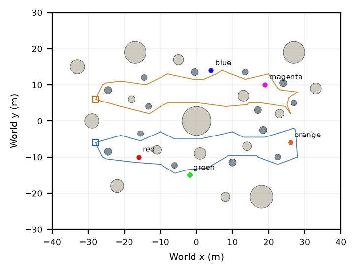
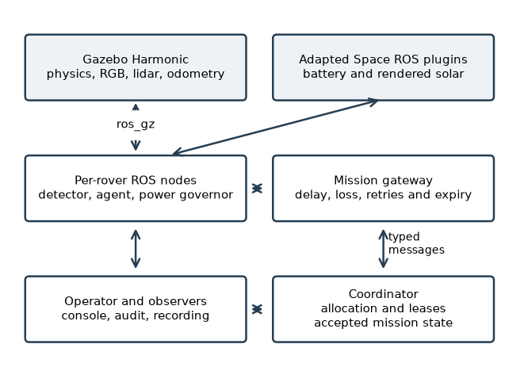

# Cooperative Lunar Exploration

[](https://github.com/henrique-correia-it/cooperative-lunar-exploration/actions/workflows/linux-checks.yml)


[](LICENSE)

A team of two rovers explores a simulated lunar outpost in **ROS 2 Jazzy** and
**Gazebo Harmonic**. They find scientific markers with their cameras, share what
they see, split the inspections between them, survive a rover failure and drive
back to base, all while their batteries drain, recharge in the sun and fall into
the shade of the terrain.

The research question: **does allocating tasks by battery state improve the
mission compared with simply sending the nearest rover**, under exactly the same
safety rules? The answer was measured in 16 paired Gazebo runs and written up as
an [IEEE-format paper](report/rsdis_paper.pdf).

<p align="center">
  
</p>

## Highlights

- **Multi-robot coordination:** one owner per target, renewable leases, retries
  and stale-rover detection, so no target is inspected twice and none is lost.
- **Two allocation policies** with identical feasibility checks: nearest rover
  (baseline) and battery-aware scoring.
- **Camera perception:** OpenCV colour detection with range estimation from the
  marker's known diameter, shared as typed ROS messages in a common world frame.
- **Navigation:** bounded A*, footprint inflation, mapped hazards, peer detours,
  short-lived laser obstacle memory and braking checks.
- **Realistic energy:** C++ Gazebo plugins adapted from Space ROS for
  rechargeable batteries and solar panels with rendered shadowing, reported as
  standard `sensor_msgs/BatteryState` and electrical telemetry in V, A and Wh.
- **Unreliable communications:** explicit DDS QoS plus seeded packet loss,
  delay and outages at the application level, with bounded retries.
- **Failure recovery:** disabling a rover releases its task, which the other
  rover picks up.
- **Mission control console:** live web map with cameras, routes, battery levels,
  an activity log and pause, resume, recall and rover enable/disable controls.
- **Reproducibility:** frozen scenarios, a source fingerprint in every run, and
  GitHub Actions running the real sensors and complete missions on Linux.

## Results

16 Gazebo runs on 8 frozen, paired layouts, each run once with `nearest` and once
with `energy` allocation.

| Measure | Result |
| --- | --- |
| Missions completed | **16 / 16** (all five targets confirmed, both rovers back at base) |
| Footprint overlaps with obstacles | **0** (minimum conservative gap 0.53 m) |
| Rover failures injected | all recovered; 44 cross-rover task reassignments |
| Communication outage runs | all completed despite 3,052 lost deliveries and 460 retries |
| Energy-aware vs nearest (mean paired difference) | **-9.37 s** mission time, **-2.90 m** distance, **-0.102 Wh** discharge |

The energy-aware policy was faster, shorter and used less energy on average, but
the effect varies between layouts. With two seeds and asynchronous simulation we
report it as a descriptive result, not as statistical superiority. Every
individual run, with its raw telemetry, is in
[`examples/paired_gazebo_20261108/`](examples/paired_gazebo_20261108/); the full
record is in [docs/VALIDATION.md](docs/VALIDATION.md).

## Architecture

<p align="center">
  
</p>

| ROS 2 package | Contents |
| --- | --- |
| [`rsdis_lunar`](src/rsdis_lunar/rsdis_lunar/) | Python nodes: coordinator, rover agents, detector, navigation and planning, power, network emulation, dashboard, recorder, launch and mission configs |
| [`rsdis_interfaces`](src/rsdis_interfaces/msg/) | Messages for detections, tasks, rover status and mission state |
| [`rsdis_energy_plugins`](src/rsdis_energy_plugins/) | C++ Gazebo plugins for rechargeable batteries and solar panels, adapted from Space ROS |

More detail in [docs/ARCHITECTURE.md](docs/ARCHITECTURE.md) and
[docs/NAVIGATION.md](docs/NAVIGATION.md).

## Quick start

Target environment: **Ubuntu 24.04, ROS 2 Jazzy and Gazebo Harmonic**.

1. Install ROS 2 Jazzy with the [official instructions](https://docs.ros.org/en/jazzy/Installation/Ubuntu-Install-Debs.html).
2. Install the project's dependencies and build:

   ```bash
   bash scripts/setup_ubuntu.sh
   ```

3. Launch the two-rover mission on the 80 x 60 m outpost:

   ```bash
   bash scripts/run_demo.sh
   ```

   Open the mission control console at <http://localhost:8765>.

4. Check that cameras, odometry, detections and assignments work (stop the
   previous launch first):

   ```bash
   source /opt/ros/jazzy/setup.bash
   source install/setup.bash
   python3 scripts/smoke_test_ros.py --timeout 180
   ```

### Useful options

```bash
bash scripts/run_demo.sh strategy:=nearest           # baseline allocation
bash scripts/run_demo.sh headless:=true              # no Gazebo GUI
bash scripts/run_demo.sh network_profile:=outage     # communication fault experiment
bash scripts/run_demo.sh rviz:=true                  # RViz view (needs ros-jazzy-rviz2)
bash scripts/run_demo.sh model:=viper                # detailed Space ROS VIPER rover
bash scripts/run_demo.sh config:="$PWD/src/rsdis_lunar/config/mission_small.json"  # 40 x 30 m map

# Inject a failure and restore it, from a second sourced terminal
ros2 service call /rover1/set_enabled std_srvs/srv/SetBool '{data: false}'
ros2 service call /rover1/set_enabled std_srvs/srv/SetBool '{data: true}'

# Recall both rovers
ros2 service call /mission/recall std_srvs/srv/Trigger '{}'
```

The VIPER model needs its assets first: `python3 scripts/fetch_upstream.py --assets`
and `python3 scripts/prepare_viper.py --validate-sdf` (see [docs/UPSTREAM.md](docs/UPSTREAM.md)).
Each run writes its telemetry, events, configuration and summary to a unique
folder under `results/`.

### Without ROS (any OS)

The offline rehearsal shares the real coordinator and rover logic, with simple
kinematics and oracle detections, and writes an HTML playback of the mission:

```bash
python scripts/offline_demo.py
python scripts/offline_demo.py --failure-at 20 --failure-duration 30
python scripts/compare_offline.py --seeds 3
```

It is a debugging tool, not evidence of camera accuracy or physical feasibility.

## Experiments and tests

```bash
# Portable tests (standard library; OpenCV image tests run when it is installed)
python3 -m unittest discover -s tests -v

# Record a real expanded-map run with video and a ROS bag
python3 scripts/create_scenarios.py --count 1 --output results/demo_scenarios
python3 scripts/run_experiment_ros.py --config results/demo_scenarios/failure_00.json \
  --strategy energy --record-video --record-bag --wall-timeout 2400
```

The paired comparison protocol is in [docs/EXPERIMENTS.md](docs/EXPERIMENTS.md).
GitHub Actions builds the packages in a Jazzy container and runs the real sensor
smoke test, a complete compact mission with a clearance audit, and the expanded
map with an injected rover failure.

A Docker build is also available:

```bash
docker build -f docker/Dockerfile -t rsdis-lunar .
docker run --rm -e LIBGL_ALWAYS_SOFTWARE=1 -v "$PWD/results:/workspace/results" rsdis-lunar
```

## Repository layout

```text
src/            ROS 2 packages (mission logic, interfaces, Gazebo energy plugins)
worlds/         Lunar test field (SDF)
scripts/        Setup, launch, experiments, analysis and offline rehearsal
tests/          Portable unit tests
experiments/    Frozen scenario definitions
examples/       Recorded runs used as evidence, with HTML playbacks
report/         IEEE paper (PDF and LaTeX), figures and final presentation
docs/           Architecture, navigation, experiments, validation and upstream notes
docker/         Container build
```

## Assumptions and limitations

- Odometry is ground truth from the simulator; there is no SLAM.
- Rocks, structures and crater exclusions are a known prior map. Target positions
  still come only from camera detections.
- Craters are visual features with navigation exclusions, not a physical heightmap.
- Coloured spheres stand in for points of scientific interest.
- Battery capacity, electrical coefficients and dock power are accelerated
  demonstration values, not calibrated VIPER data.

## Team

Developed for the Distributed Sensor Networks course (RSDIS) of the MSc in
Electrical and Computer Engineering at ISEP (Instituto Superior de Engenharia do
Porto), 2026.

- **Henrique Correia** ([@henrique-correia-it](https://github.com/henrique-correia-it)): perception, map and motion
- **Pedro Ribeiro** ([@pedror1beiro](https://github.com/pedror1beiro)): ROS and Gazebo integration, energy
- **Francisco Liquito** ([@FranciscoLiquito19](https://github.com/FranciscoLiquito19)): cooperation, communication and evaluation

## Credits and license

The energy plugins and the optional VIPER rover are adapted from
[Space ROS demos](https://github.com/space-ros/demos) and
[Space ROS simulation](https://github.com/space-ros/simulation); see
[NOTICE](NOTICE) and [docs/INTEGRATION_SOURCES.md](docs/INTEGRATION_SOURCES.md).
External files keep their original licences. Everything else is released under
the [Apache License 2.0](LICENSE).
